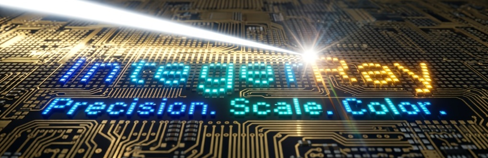

# IntegerRay

C++11 Arduino-compatible software library for efficient RGB/RGBW LED strip animation, color grading, and integration with external addressable LED drivers, using a 15 bit-per-channel HDR internal color model.

## Driver adapters

The library does not include hardware transports. Its optional ready-to-use strip drivers wrap transports from these libraries:

- `IntegerRayInertia.h` provides IntegerRay drivers wrapping [Inertia](https://github.com/GitMoDu/Inertia) transports.
- `IntegerRayAdafruit.h` provides an IntegerRay driver wrapping [Adafruit NeoPixel](https://github.com/adafruit/Adafruit_NeoPixel).
- `IntegerRayFastLED.h` provides an IntegerRay driver wrapping [FastLED](https://github.com/FastLED/FastLED) controllers.
- `IntegerRayNeoPixelBus.h` provides an IntegerRay driver wrapping [NeoPixelBus](https://github.com/Makuna/NeoPixelBus).

## Output conversion memory

`TemplateRayEngine` takes `IntegerRay::Engine::ConversionModeEnum` as a template argument:

- `SeparateOutputBuffer` converts the HDR draw frame into a distinct native output frame. The HDR frame remains intact during conversion. 
Adafruit NeoPixel and NeoPixelBus require this mode because they write into library-owned pixel buffers; Inertia and FastLED adapters can also use it.
- `ReuseDrawBuffer` converts in place, overwriting and reusing the draw-buffer memory for native output. 
This saves the separate native frame, but the HDR draw values are no longer preserved after conversion.
It requires a driver adapter that accepts an external output frame, such as Inertia or FastLED. It is not supported by the Adafruit NeoPixel or NeoPixelBus adapters.
Size compatibility is checked at compile time so the native frame fits in the draw-buffer storage.

The engine converts the completed HDR draw frame before waiting for the frame deadline and driver readiness. It pushes the converted frame after that wait. With `ReuseDrawBuffer`, the draw buffer contains native output after conversion and is cleared before the next draw frame.

## Features

- Cooperative scheduling engine based on [TaskScheduler](https://github.com/arkhipenko/TaskScheduler).
- HDR internal color model (15x15x15 bits color) for interpolation and effects from [IntegerSignal](https://github.com/GitMoDu/IntegerSignal).
- Compile-time choice of separate output storage or in-place draw-buffer reuse for HDR-to-native conversion.
- Adapters for external addressable LED drivers.

## Example

See [`examples/SimpleLight/SimpleLight.ino`](examples/SimpleLight/SimpleLight.ino) for a basic animated LED-strip setup with Adafruit, Inertia, FastLED, or NeoPixelBus adapters and compile-time conversion-mode selection.

