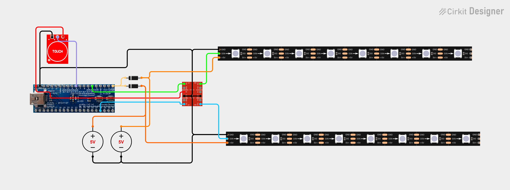

# CouchLight

CouchLight is a two-strip lighting installation built with IntegerRay. It is kept as a real-world example of IntegerRay usage. Each strip has its own engine, while both share the same lighting state. A capacitive touch sensor controls the modes.

## Hardware and wiring

- Board: Maple Mini with Roger’s Core, configured for STM32F103CB (128 KiB flash).
- Top strip: 207 SK6812 RGBW pixels using SPI DMA on `SPIClass(2)`; data output on `PB15`.
- Bottom strip: 209 SK6812 RGBW pixels using SPI DMA on the default SPI peripheral; data output on `PA7`.
- Touch sensor: active-high input on `PA3` with an internal pull-down.
- The strip data lines use a level shifter.
- Each strip has its own independent 5 V power supply.

## Controls and lighting modes

A short touch cycles through the lighting modes:

1. Colored dim
2. Colored bright
3. White lighting
4. Colored dim

A long touch turns both strips off. A short touch from off starts colored dim. Colored bright and white lighting are reached from colored dim.

Animation timing and color settings are in `Model.h`; per-strip pixel rendering is in `StripDrawer.h`.

## Schematic

The schematic is available in [Cirkit Designer](https://app.cirkitdesigner.com/project/1b86eb59-9a2f-410b-a4ee-c4058eb3bb3f).

## Building and installing

1. Install the STM32 board core and the TaskScheduler dependency.
2. Install IntegerRay and its IntegerSignal dependency in the Arduino libraries directory.
3. Open `CouchLight.ino` in the Arduino IDE and select the target board.
4. Check the driver types, SPI peripherals, strip counts, and pin assignments in `Device.h` against the hardware.
5. Connect the level-shifted data lines and the two independent strip power supplies as shown in the schematic.
6. Compile and upload. Enable `DEBUG` in `CouchLight.ino` to see setup and state-transition messages over serial.

## Main configuration files

- `Device.h` — board pins, SPI peripherals, pixel counts, gamma strength, and top-strip red-blue balance.
- `Model.h` — lighting modes, button timing, animation durations, colors, and brightness/saturation targets.
- `StripDrawer.h` — per-pixel rendering and animation state.
- `StateController.h` — touch input parsing and lighting-state transitions.
- `CouchLight.ino` — driver and engine setup, callbacks, and startup.
